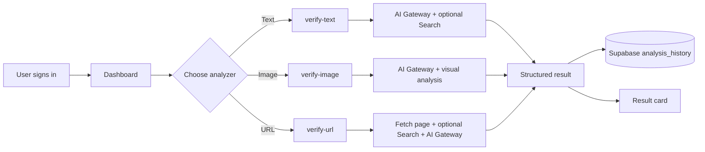

# 🔎 VERIFY-AI

> **AI-powered verification for claims, images, and online sources.**

VERIFY-AI helps you investigate questionable content before you share it. Sign in, submit a text claim, image, or URL, and receive an AI-assisted result with a verdict, confidence or credibility score, findings, and searchable history.

[](https://react.dev/)
[](https://www.typescriptlang.org/)
[](https://vite.dev/)
[](https://supabase.com/)
[](https://tailwindcss.com/)

## ✨ Contents

- [What it does](#-what-it-does)
- [Key features](#-key-features)
- [Technology stack](#-technology-stack)
- [How it works](#-how-it-works)
- [Getting started](#-getting-started)
- [Environment variables](#-environment-variables)
- [Supabase functions](#-supabase-functions)
- [Project structure](#-project-structure)
- [Available scripts](#-available-scripts)
- [Security notes](#-security-notes)
- [Contributing](#-contributing)

## 🎯 What it does

| Analyzer | Input | Result |
| --- | --- | --- |
| 📝 Text verification | A claim or statement | `TRUE`, `FALSE`, or `UNCERTAIN`, with confidence and key points |
| 🖼️ Image verification | An uploaded image | `AUTHENTIC`, `MANIPULATED`, or `UNCERTAIN`, with confidence and forensic findings |
| 🌐 URL verification | A webpage URL | Trust verdict, domain credibility score, reputation, and findings |

> ⚠️ Results are AI-assisted signals, not a substitute for professional fact-checking or independent source evaluation.

## 🚀 Key features

- 🔐 Email/password authentication with password reset support
- 🧠 AI-assisted analysis powered by Gemini through the Lovable AI Gateway
- 🔍 Optional Google Custom Search context for text and URL verification
- 📊 Dashboard with dedicated text, image, and URL analyzers
- 🕘 Per-user analysis history stored securely in Supabase
- 🛡️ Row Level Security (RLS) policies protecting user history
- 📱 Responsive UI built with Tailwind CSS and shadcn/ui primitives
- 🔔 Toast notifications and clear loading/error states

## 🧰 Technology stack

| Layer | Tools and technologies |
| --- | --- |
| Frontend | React 18, TypeScript, Vite 7 |
| UI | Tailwind CSS, shadcn/ui, Radix UI, Lucide React |
| State and forms | TanStack React Query, React Hook Form, Zod |
| Authentication | Supabase Auth |
| Database | Supabase Postgres with RLS |
| Serverless APIs | Supabase Edge Functions running on Deno |
| AI | Google Gemini 2.5 Flash through the Lovable AI Gateway |
| Search enrichment | Google Custom Search JSON API (optional) |
| Quality tooling | ESLint, TypeScript, PostCSS, Autoprefixer |
| Package managers | npm and Bun lockfile support |

## 🔄 How it works



## 🛠️ Getting started

### Prerequisites

| Requirement | Recommended |
| --- | --- |
| Node.js | 18+ |
| npm | 9+ |
| Supabase project | Required for auth, database, and Edge Functions |
| Supabase CLI | Required only for local function/database workflows |

### Install and run locally

```bash
git clone https://github.com/Aviral02728/VERIFY-AI.git
cd VERIFY-AI
npm install
# Create .env manually (see Environment variables)
npm run dev
```

Open the local URL printed by Vite, usually `http://localhost:5173`.

## 🔑 Environment variables

Create a `.env` file in the project root. Never commit real credentials.

| Variable | Used by | Required |
| --- | --- | --- |
| `VITE_SUPABASE_URL` | Frontend Supabase client | ✅ |
| `VITE_SUPABASE_PUBLISHABLE_KEY` | Frontend Supabase client | ✅ |
| `LOVABLE_API_KEY` | All verification functions | ✅ |
| `GEMINI_API_KEY` | Text and URL function configuration checks | ✅ |
| `GOOGLE_SEARCH_API_KEY` | Optional Google search enrichment | Optional |
| `GOOGLE_SEARCH_ENGINE_ID` | Optional Google search enrichment | Optional |

Configure function secrets server-side with Supabase:

```bash
supabase secrets set LOVABLE_API_KEY=your_key
supabase secrets set GEMINI_API_KEY=your_key
supabase secrets set GOOGLE_SEARCH_API_KEY=your_key
supabase secrets set GOOGLE_SEARCH_ENGINE_ID=your_engine_id
```

## ⚡ Supabase functions

| Function | Method | Purpose |
| --- | --- | --- |
| `verify-text` | `POST` | Checks a claim and returns verdict, confidence, explanation, and key points |
| `verify-image` | `POST` | Analyzes an image for authenticity and manipulation indicators |
| `verify-url` | `POST` | Fetches a page, evaluates source credibility, and returns a domain score |

All three functions require JWT verification and return JSON. The frontend invokes them through the Supabase client.

### Deploy functions

```bash
supabase login
supabase link --project-ref ioikabbsoxnmqrspebfm
supabase functions deploy verify-text
supabase functions deploy verify-image
supabase functions deploy verify-url
supabase db push
```

## 📁 Project structure

```text
├── src/
│   ├── components/
│   │   ├── analyzers/        # Text, image, URL, and history views
│   │   ├── ui/               # Reusable shadcn/ui components
│   │   ├── Auth.tsx
│   │   ├── Dashboard.tsx
│   │   └── LandingPage.tsx
│   ├── contexts/              # Authentication context
│   ├── integrations/supabase/ # Typed Supabase client and auth storage
│   ├── pages/                 # Route-level pages
│   └── App.tsx                # Application shell and auth routing
├── supabase/
│   ├── functions/             # Verification Edge Functions
│   └── migrations/            # Database schema and RLS policies
├── public/                     # Static assets
├── package.json
└── vite.config.ts
```

## 📜 Available scripts

| Command | Description |
| --- | --- |
| `npm run dev` | Start the Vite development server |
| `npm run build` | Create a production build |
| `npm run build:dev` | Create a development-mode build |
| `npm run lint` | Run ESLint |
| `npm run preview` | Preview the production build locally |

## 🛡️ Security notes

- 🔒 Keep API keys in Supabase Edge Function secrets; do not place them in client-side code.
- 👤 The `analysis_history` table uses RLS so authenticated users can access only their own records.
- 🚫 Treat AI outputs as advisory and verify important claims against primary sources.
- 🧪 Review and validate external page content before using URL analysis in production workflows.

## 🤝 Contributing

1. Create a feature branch.
2. Make focused changes with clear naming and accessible UI states.
3. Run `npm run lint` and `npm run build`.
4. Open a pull request describing the user-facing impact and validation performed.

---

Built with ⚛️ React, ⚡ Vite, 💚 Supabase, and 🧠 AI.
